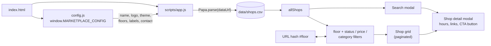

# Marketplace Directory Template

**A ready-to-brand shop directory for a food court, market hall or shopping centre: edit one config file and one CSV, host it anywhere static.**

[](https://github.com/LuisEduardoGE/marketplace-directory-template/actions/workflows/ci.yml)
[](LICENSE)


[](https://luiseduardoge.github.io/marketplace-directory-template/)

A static, mobile-first directory: shops grouped by floor, with search, filters (open/closed, price, category), opening hours and an optional "order / visit" button per shop.

No build step, no backend: plain HTML/CSS/JS, a CSV for the data, and one config file for the branding. Host it anywhere static (GitHub Pages works out of the box).

**[Live demo](https://luiseduardoge.github.io/marketplace-directory-template/)**, with fictional sample data.

## Table of Contents

- [Features](#features)
- [Tech Stack](#tech-stack)
- [Architecture](#architecture)
- [Quick Start](#quick-start)
- [Make your own](#make-your-own)
- [CSV columns](#csv-columns)
- [Translating](#translating)
- [Testing](#testing)
- [Project Structure](#project-structure)
- [Content and trademarks](#content-and-trademarks)
- [Notes](#notes)
- [Author](#author)
- [License](#license)

## Features

- **Floors**: one button per floor from `config.floors`; the selected floor is kept in the URL hash (`#1`), and swiping up/down changes floor on touch screens.
- **Shop cards** with logo (or a generated coloured initials badge), price level, star rating, open/closed status and category tags; paginated, 6 per page (3 on narrow phones), swipe left/right to page.
- **Filters** by status, price level and category (the category list is built from the CSV).
- **Search** by shop name or category.
- **Shop detail** view with opening hours, description, phone and social links, and an optional call-to-action button.
- **Fully configurable branding**: name, logo, colours, contact details and every UI label, so the whole site can be translated.

## Tech Stack

| Layer | Choice |
|---|---|
| Markup / styling | Plain HTML + CSS (`styles/main.css`), Inter from Google Fonts |
| Logic | Vanilla JavaScript (`scripts/app.js`), no framework, no build step |
| CSV parsing | PapaParse 5.4.1 from cdnjs (pinned with SRI) |
| Icons | Font Awesome 6.5.2 from cdnjs (pinned with SRI) |
| Tests | Node.js built-in test runner (`node --test`), zero dependencies |
| Hosting | Any static host; demo on GitHub Pages |

## Architecture



`index.html` loads `config.js` first, which sets `window.MARKETPLACE_CONFIG`; `scripts/app.js` then applies the branding, labels and theme colours, builds the floor buttons and downloads the CSV with PapaParse. Every render filters the parsed rows by the active floor and the filter modal, paginates them and builds the cards. All CSV values are HTML-escaped and links are restricted to `http(s):` and `tel:`.

## Quick Start

Prerequisites: Python 3 (for the local server), Node.js 18+ (only for tests), and `make` (optional).

```bash
make run         # serves the site on a free port, e.g. http://localhost:50810 (PORT=8080 to pick one)
```

Without make, use any static server, e.g. `python -m http.server 8080` and open <http://localhost:8080>. Opening `index.html` as a file won't load the CSV.

Run `make` with no arguments to list all targets (`run`, `test`, `lint`).

## Make your own

1. Click **Use this template** on GitHub (or fork / download).
2. Edit **`config.js`**: name, logo, floors, colours, contact, button text and every UI label.
3. Replace **`data/shops.csv`** with your shops (columns below).
4. Put your logo in `assets/` and point `config.logo` at it.
5. Run `make test` to check the config and CSV.
6. Enable GitHub Pages (Settings → Pages → Deploy from branch → `main` / root).

Main `config.js` keys:

| Key | Example | Purpose |
|---|---|---|
| `name` | `"Sample Food Market"` | Page title and logo alt text |
| `logo` | `"assets/logo.svg"` | Header logo; omit to hide it |
| `lang` | `"en"` | `<html lang>` |
| `dataUrl` | `"data/shops.csv"` | CSV with the shops |
| `floors`, `defaultFloor` | `["2", "1", "0"]`, `"0"` | Floor buttons top to bottom, and the one selected on first load |
| `theme` | `{ header, accent, button, buttonHover }` | Colours (header, price badge, buttons) |
| `orderButton` | `{ label: "Visit shop", fallbackUrl: "" }` | Per-shop call-to-action; a shop's `external_url` wins, `null` removes it |
| `contact` | `{ email, phone }` | Shown in the contact dialog |
| `labels` | see [Translating](#translating) | Every UI string, plus `labels.days` |

## CSV columns

| Column | Required | Example | Notes |
|---|---|---|---|
| `floor` | yes | `1` | Must match one of `config.floors` |
| `shop_name` | yes | `Pasta Fresca` | |
| `status` | yes | `Open` / `Closed` | |
| `price` | no | `1`–`3` | Shown as `$`–`$$$` |
| `categories` | no | `Italian,Pizza` | Comma-separated; filter list is built from these |
| `rating`, `reviews` | no | `4.5`, `143` | Leave `rating` empty to hide stars |
| `hours` | no | `{"Monday": "10:00 - 22:00"}` | JSON object; day names are translated via `labels.days` |
| `logo_url` | no | `assets/shops/pasta.png` | Empty → generated initials badge |
| `phone` | no | `+00 000 000 000` | |
| `social` | no | `instagram.com/yourshop` | Comma-separated |
| `external_url` | no | `https://…` | Target of the per-shop button |
| `description` | no | free text | Shown in the shop detail view |

## Translating

All text lives in `config.labels`. Portuguese, for example:

```js
labels: {
  search: "Pesquisar", searchTitle: "Pesquisar lojas", searchPlaceholder: "Pesquisar por nome, categoria…",
  noResults: "Nenhum resultado encontrado.", filters: "Filtros", filterTitle: "Filtrar lojas",
  floors: "Pisos", floor: "Piso", status: "Estado", all: "Todos", open: "Aberto", closed: "Fechado",
  price: "Preço", categories: "Categorias", apply: "Aplicar", reset: "Limpar",
  previous: "Anterior", next: "Próximo", page: "Página", of: "de", hours: "Horário",
  contactTitle: "Contacto", contactText: "Precisa de ajuda? Contacte-nos em",
  settingsTitle: "Configurações", settingsText: "Nada para configurar ainda.",
  days: { Monday: "Segunda-feira", Tuesday: "Terça-feira", Wednesday: "Quarta-feira",
          Thursday: "Quinta-feira", Friday: "Sexta-feira", Saturday: "Sábado", Sunday: "Domingo" },
},
```

## Testing

```bash
make test        # node --test tests/*.test.mjs
make lint        # node --check on config.js and scripts/app.js
```

16 tests, no dependencies. They load `config.js` the way the browser does and check the required keys (name, lang, dataUrl, floors including `defaultFloor`, theme colours, `orderButton`, contact), that every label used by `index.html` and `scripts/app.js` exists in `config.labels`, and that `labels.days` covers all weekdays. They parse `data/shops.csv` and check the required columns, no misspelled columns, one value per column, valid status, floors that exist in the config, price/rating/review ranges, `hours` JSON keyed by weekday and `http(s)` links. CI runs lint and tests on every push and pull request to `main`.

## Project Structure

```
index.html        page skeleton, modals, CDN scripts (PapaParse, Font Awesome)
config.js         branding, floors, colours, contact, UI labels
data/shops.csv    the shop list
scripts/app.js    rendering, filters, search, pagination, swipe
styles/main.css   all styles
assets/           logo and favicon
tests/            node --test checks for config.js and the CSV
Makefile          run / test / lint
```

## Content and trademarks

The sample shops, logo and data are fictional. When you publish a real directory, only use
shop names, logos, photos and ratings you have permission to use — brand logos and
third-party ratings (e.g. from map services) are usually protected.

## Notes

- Every value from the CSV is HTML-escaped and links are limited to `http(s):`/`tel:`, so a
  bad row can't inject script.
- Third-party assets (PapaParse script, Font Awesome stylesheet) are pinned with Subresource Integrity hashes.

## Author

**Luis Eduardo G. Espindola** · [GitHub](https://github.com/LuisEduardoGE) · [LinkedIn](https://www.linkedin.com/in/luisgespindola/)

## License

[MIT](LICENSE) © Luis Eduardo G. Espindola
